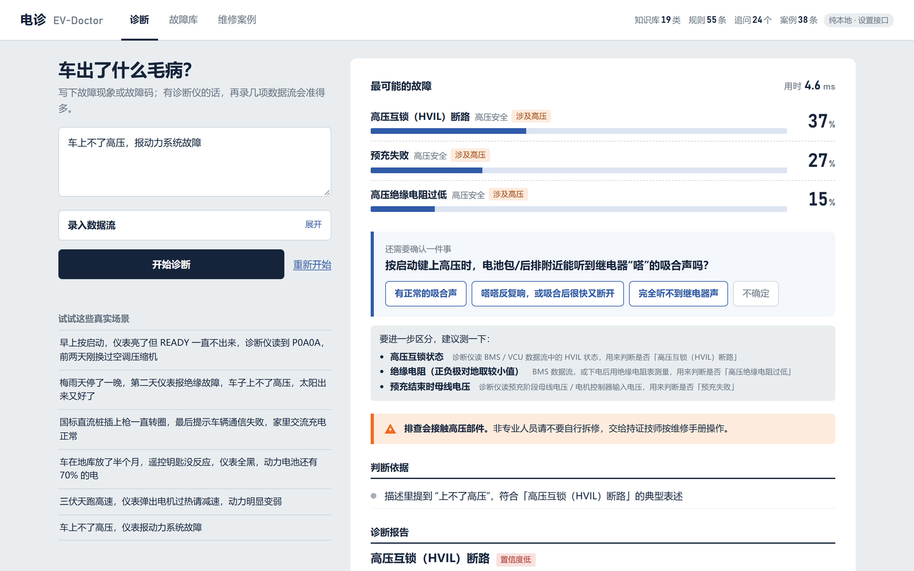
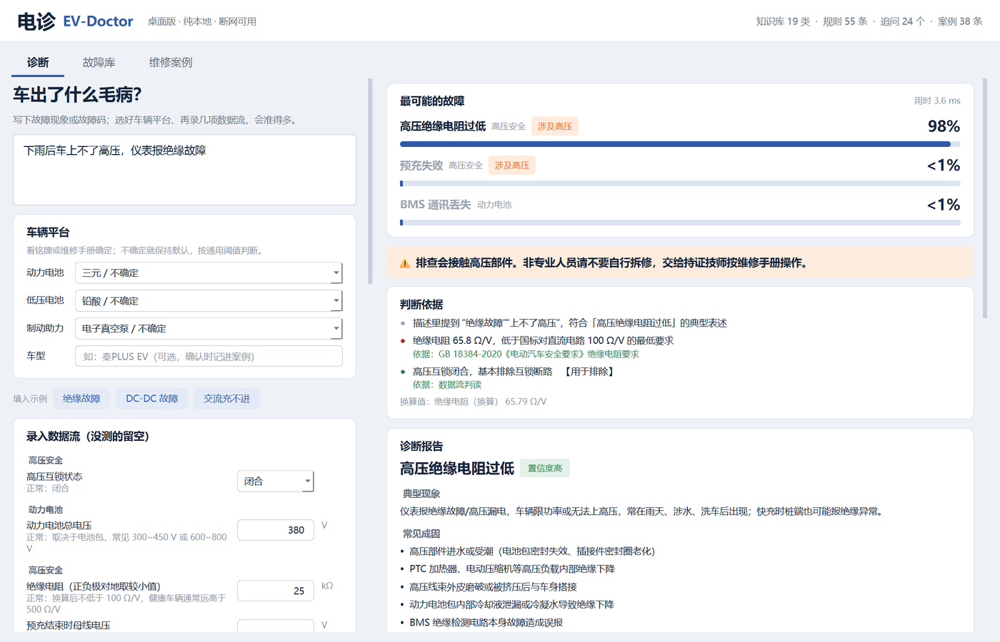
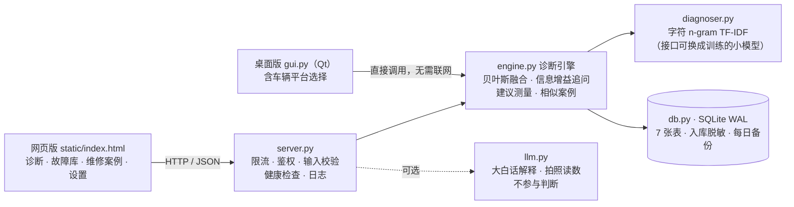
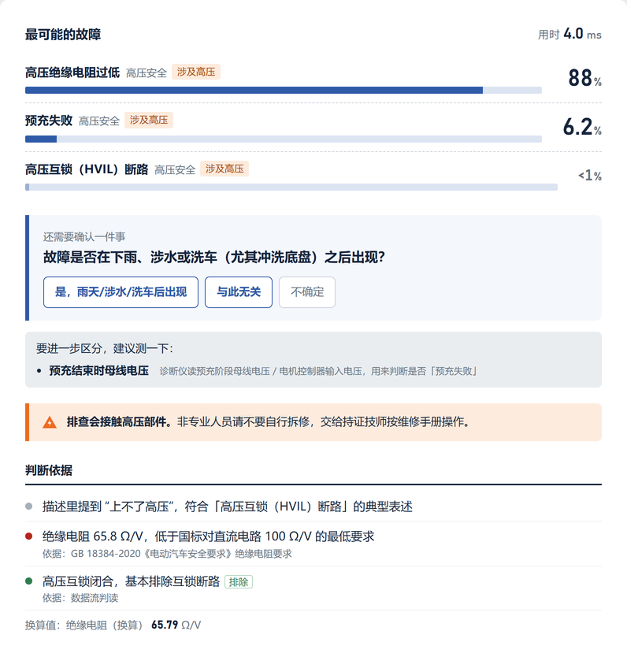
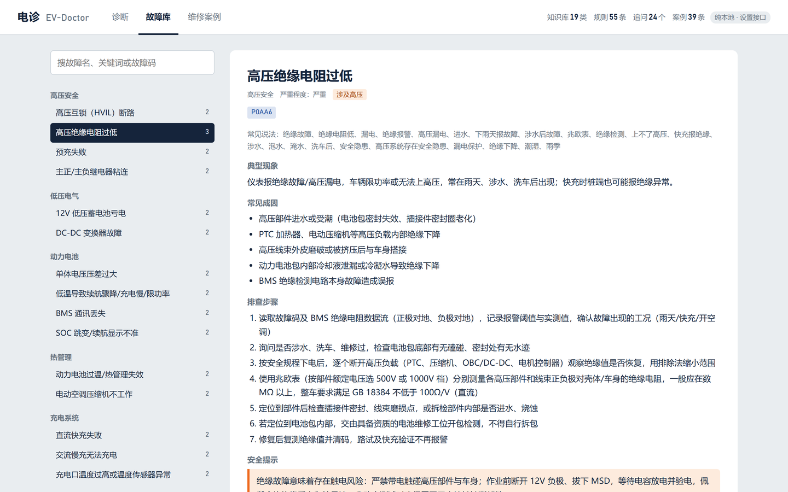

# 电诊 EV-Doctor —— 新能源汽车故障诊断 Agent

[](https://github.com/zijin1337/ev-doctor/actions/workflows/test.yml)


给维修门店和车队技师用的诊断工具。输入故障现象或故障码，录几项诊断仪数据流，系统按国标阈值判断异常，算出各类故障的概率；分不清时一次只问一个最关键的问题；修好后确认，案例写回数据库，越用越准。

**在线演示：** http://47.122.108.57



**诊断不依赖大模型。** 判断全部在本地完成：SQLite 数据库 + 国标阈值规则 + 贝叶斯推理，断网也能用，单次诊断约 4 ms（本机实测）。大模型接口作为**可选增强**保留，只负责“嘴”和“眼”——把结论讲成大白话、识别诊断仪照片里的读数——不参与判断。拔掉大模型，诊断结论一个字都不变。

## 和直接问豆包 / ChatGPT 有什么不同

| | 通用聊天机器人 | 电诊 |
|---|---|---|
| 输入 | 只能听人描述 | 描述 + 诊断仪实测数据流 |
| 判断 | 凭语言模型“感觉” | 按 GB 18384、GB/T 18487.1 等阈值逐条判定，再用贝叶斯融合 |
| 出处 | 可能编造故障码和数值 | 每条判断标明依据的国标条款或工程经验 |
| 交互 | 回一大段文字 | 每次只问一个信息量最大的问题；说不清时不硬给结论 |
| 积累 | 记不住你修过的车 | 确认的案例写回本地数据库，下次认得更准 |
| 部署 | 要联网、按次计费 | 本地运行、零依赖、数据不出门店 |

## 快速开始

只需要 Python 3.8+，不用装任何包（见 `requirements.txt`）。

```
python server.py
```

浏览器打开 http://127.0.0.1:8000 。Windows 可以直接双击 `start.bat`。第一次启动会自动创建 `data/evdoctor.db` 并导入种子数据；想恢复出厂数据：`python db.py --reset`。

页面上有“试试这些真实场景”和“填入示例”按钮，点一下就能看到完整流程。

### 桌面版

原生桌面程序（Qt），直接调用本地诊断引擎，不用起网页服务，断网可用，和网页版共用同一个数据库。比网页版多一个**车辆平台选择**（动力电池、低压电池、制动助力，见下文“不同车型怎么办”）。

Windows 双击 `start_gui.bat`（第一次运行会自动安装界面库 PySide6，约 70 MB），或者：

```
pip install PySide6-Essentials
python gui.py
```

诊断核心和网页版仍然零依赖，只有桌面版需要 PySide6。



## 技术架构



| 文件 | 作用 |
|---|---|
| `server.py` | HTTP 服务（纯标准库 `ThreadingHTTPServer`）：路由、限流、管理口令、请求大小与格式校验、健康检查、日志、定时备份 |
| `engine.py` | 诊断引擎：数据流规则匹配、贝叶斯融合、期望信息增益选题、建议测量、相似案例；知识库快照原子替换 |
| `diagnoser.py` | 文本匹配模型（字符 n-gram TF-IDF 基线），统一 `rank(text)` 接口，可替换 |
| `db.py` | SQLite 建表、导入、查询、写回；每线程独立连接 + WAL；入库前脱敏 |
| `privacy.py` | 脱敏：手机号、车牌、VIN、身份证号 |
| `llm.py` | 可选的大模型调用：大白话解释（流式）、拍照识别（结果按参数白名单过滤） |
| `eval.py` | 准确率评测：开发集 + 留出集，`python eval.py -v` 看错例 |
| `data/*.json` | 知识库：19 类故障、55 条规则、21 项参数、24 个追问、38 条种子案例、参考标准、57 条评测样本、车辆平台档案 |
| `static/index.html` | 网页版前端：诊断 / 故障库 / 维修案例 / 设置 |
| `gui.py` / `start_gui.bat` | 桌面版（Qt / PySide6）：诊断（含车辆平台选择）/ 故障库 / 维修案例，双击启动 |
| `tests/` | 40 个单元测试 |
| `deploy/` | 一键部署脚本（systemd + nginx + HTTPS）、Dockerfile |
| `requirements.txt` / `pyproject.toml` | 依赖声明（无第三方依赖）与项目元数据 |

数据库 7 张表：`faults` 故障库 · `fault_dtc` 故障码索引 · `params` 数据流参数 · `rules` 阈值规则 · `questions` 追问 · `cases` 维修案例（种子 + 确认） · `diagnoses` 诊断记录。

## 核心算法（自主实现，不依赖任何机器学习库）

```
P(故障 | 证据) ∝ P(故障 | 文字描述)^0.6 × Π 数据流规则似然比 × Π P(回答 | 故障)
```

1. **文字先验**（`diagnoser.py`）：中文不分词，直接切 1~3 字符片段做 TF-IDF。每类故障打分 = 0.45 × 与整体语料的余弦 + 0.55 × 与最像示例的余弦 + 关键词命中（专属词加分多，共用词加分少）+ 故障码精确匹配，softmax（温度 0.05）后留 3% 平滑。进入融合前再开 0.6 次方，防止短句“过度自信”。
2. **数据流似然比**（`rules` 表）：55 条阈值规则，区间左闭右开、相邻不重叠（单元测试保证）。先算派生量（绝缘电阻 Ω/V、单体压差、温差、预充比例），命中的规则给相关故障乘似然比；正常值同样参与计算，用来排除故障。来源：16 条引自国标，11 条来自 ISO 11898 和维修手册，28 条为工程经验（以车型维修手册为准）。
3. **贝叶斯融合**（`engine.py`）：在对数空间累加先验、似然比和回答的条件概率，再归一化，避免连乘下溢。
4. **期望信息增益选题**：对每个没问过的问题计算 `IG = H(当前分布) − Σ P(回答)·H(回答后的分布)`，挑最大的问；增益低于 0.08 bit 或首位超过 90% 就停。已录入对应数据流的问题不再重复问。
5. **知道自己不知道**：描述里没有可用信号（如“123”“车坏了”）就用均匀先验；没有硬证据且首位不到 25% 时不出诊断报告，只追问。
6. **建议测量**：前几名分不开时，挑对它们区分力最大（|log 似然比| 最大）且还没测的参数，提示技师下一步测什么。
7. **越用越准**：技师确认后，案例并进对应故障的语料，知识库快照在锁外重建、原子替换，正在进行的诊断不受影响。

例：“车上不了高压，报动力系统故障”只看文字时，互锁断路 37%、预充失败 27%、绝缘电阻过低 15%；再录入电池电压 380 V、绝缘电阻 25 kΩ、高压互锁闭合，换算 65.8 Ω/V 低于 GB 18384-2020 的 100 Ω/V，绝缘电阻过低升到 88%，互锁断路被排除。



## 不同车型怎么办：车辆平台档案

55 条规则里，27 条本身就和车型无关：绝缘电阻先换算成 Ω/V（400 V、800 V 平台用同一个国标）、预充按百分比判断、60 V 是国标安全电压分界、充电接口按 GB/T 18487.1 统一、CAN 终端电阻按 ISO 11898、互锁和冷却液只看状态。另外 28 条阈值和车型有关，按**车辆平台**而不是逐个车型调整（`data/vehicle_profiles.json`）：

| 维度 | 选项 | 调整 |
|---|---|---|
| 动力电池 | 三元 / 磷酸铁锂 | 磷酸铁锂低温阈值从 -10 ℃ 收紧到 0 ℃；电压平台平、SOC 估算更易漂移，SOC 跳变类故障先验 ×1.8 |
| 低压电池 | 铅酸 / 12V 锂电 | 12V 锂电静置平台约 13.2 V，亏电阈值从 11.8 / 12.4 V 上调到 12.8 / 13.1 V |
| 制动助力 | 电子真空泵 / 电子液压助力 | 电子液压助力没有真空泵，停用真空度规则 |

例：“早上车没反应，仪表不亮”，静置 12V 电压 12.6 V。按铅酸算电量正常，12V 低压蓄电池亏电只有 32%；选“12V 锂电”后同样的读数已是严重亏电，升到 96%。诊断依据里会写明按哪个平台调整了哪条阈值。

桌面版在左侧直接选择；接口调用时 `POST /api/diagnose` 带上 `"vehicle": {"battery": "lfp", "lv_battery": "lithium", "brake": "ehb"}`，`GET /api/vehicle` 返回可选项。不认识的取值会被忽略，按通用阈值计算。选了“12V 锂电”或“电子液压助力”时，诊断报告还会补充说明哪些排查步骤要按该平台调整。

车型和档案不完全匹配时：没录入的参数不参与判断；每条规则只是乘一个似然比，不会一票否决；不认识的故障码会提示“可能是厂家私有码，请查对应车型手册”。下一步用门店确认的案例按车型校准阈值和权重。

## 效果

`python eval.py` 输出两组数字。**看留出集**，开发集是调参时看过错例的，偏乐观：

| | 样本 | 只看文字 Top-1 | Top-3 | 文字 + 追问 Top-1 | 平均追问 |
|---|---|---|---|---|---|
| 开发集 `eval_cases.json` | 57 | 96.5% | 100% | 91.2% | 3.6 |
| **留出集** `seed_cases.json` | 38 | **71.1%** | **92.1%** | **81.6%** | 4.7 |

追问的测试方法：模拟技师按每类故障的条件概率随机作答，不是专挑对系统有利的答案。留出集评测时已把种子案例从语料中剔除，避免拿案例评案例。

## 测试与质量

```
python -m unittest discover -s tests -v     # 40 个用例
python eval.py -v                            # 准确率 + 留出集错例
```

覆盖：数据文件一致性（规则区间不重叠、引用的参数和故障都存在、条件概率合法）、文本模型、数据库读写与备份、诊断引擎（追问收敛、“不确定”回答保持中性、已测参数不重复问）、笼统描述不出报告、确认后匹配变好、8 线程 160 次并发诊断同时 5 次写回零错误、脱敏、车辆平台档案（调整后区间不重叠、锂电低压电池、磷酸铁锂低温、电子液压助力）、大模型层（本地假接口，含看图模型可用性检测）。GitHub Actions 每次 push 在 Python 3.10 / 3.12 / 3.14 上跑一遍测试和评测。

## 数据安全

- **入库前脱敏**：诊断记录和维修案例里的手机号、车牌、VIN、身份证号先遮蔽再存（`privacy.py`），如 `粤B12345 → 粤B***45`、`13812345678 → 138****5678`；描述发给大模型之前同样脱敏。原文只在本次请求的内存里用来诊断，不落盘。
- **密钥**：API key 只存在本机 `config.json`（`.gitignore` 已排除），界面只显示首尾几位；“设置”只能在运行服务的电脑上改，远程修改需要管理口令（`X-Admin-Token`，常数时间比较）。
- **输入校验与限流**：请求体 ≤ 8 MB、描述 ≤ 2000 字、数据流按参数类型和枚举值校验、大模型识别结果按参数白名单过滤；每个 IP 每分钟最多 120 次诊断类请求。
- **数据不出门店**：所有数据在本地 SQLite；每天凌晨自动备份，保留 7 天。服务器部署时后端只监听 127.0.0.1，对外走 nginx，有域名会自动签 HTTPS。

## 部署与成本

- **门店电脑**：有 Python 3.8+ 就能跑，断网可用，不需要 GPU。
- **云服务器**：一条命令完成 systemd 开机自启、nginx 反代、HTTPS、防火墙，最后打印访问地址和管理口令；再跑一次就是更新。

  ```
  git clone https://github.com/zijin1337/ev-doctor.git /opt/ev-doctor
  cd /opt/ev-doctor
  sudo DOMAIN=ev.example.com bash deploy/deploy.sh      # 没域名就去掉 DOMAIN=
  ```

  云服务器别忘了在控制台安全组放行 80/443。
- **Docker**：`docker build -t ev-doctor -f deploy/Dockerfile . && docker run -d -p 8000:8000 -v evdoctor-data:/app/data ev-doctor`
- **成本**：零第三方依赖、零授权费、零按次调用费（大模型可选）；单次诊断约 4 ms，旧电脑也够用。

### 环境变量

| 变量 | 默认 | 说明 |
|---|---|---|
| `EVDOC_HOST` | `127.0.0.1` | 监听地址；`0.0.0.0` 对外 |
| `EVDOC_PORT` | `8000` | 端口 |
| `EVDOC_ADMIN_TOKEN` | 空 | 远程修改设置的口令 |
| `EVDOC_RATE` | `120` | 每 IP 每分钟诊断请求上限，`0` 不限 |
| `EVDOC_BACKUP_HOUR` | `3` | 自动备份时刻，`-1` 关闭 |
| `EVDOC_LOG` | `data/server.log` | 日志文件 |

## 可选：接入大模型

| 功能 | 作用 | 不配置时 |
|---|---|---|
| 大白话解释 | 把本地算出的结论和依据讲给车主听。提示词限定它不许改结论、不许编数值，引用依据时标注出处 | 按钮不显示 |
| 拍照识别 | 拍诊断仪屏幕或仪表盘，自动识别读数和故障码填进表单。模型返回的非法参数被后端过滤 | 按钮不显示 |

**方式一：网页里填（推荐）。** 启动后点右上角“纯本地 · 设置接口”，选一个预设（DeepSeek / 通义 / 智谱 / OpenAI），填上 key，点“测试连接”，保存后立即生效。测试连接会用一张纯红色小图检查看图模型是否真的收到了图片（有些中转站会悄悄丢图）。

**方式二：改文件。** 按 `config.example.json` 的格式填写 `config.json`，任何 OpenAI 兼容接口都可以（包括中转站）。拍照识别需要能看图的模型，填在 `vision_model` 里。



## 知识来源与引用

阈值和排查步骤参考：GB 18384-2020《电动汽车安全要求》、GB/T 18487.1《电动汽车传导充电系统 第 1 部分：通用要求》、GB/T 27930《电动汽车非车载传导式充电机与电池管理系统之间的通信协议》、ISO 11898（CAN 总线）、SAE J2012（诊断故障码）。标注“工程经验”的阈值以具体车型维修手册为准。

项目没有引用第三方代码或依赖包，全部使用 Python 标准库。

## 免责声明

本工具只提供故障方向参考，不能替代专业检修。高压系统（橙色线束、电池包、电机控制器等）的作业必须由持证人员按维修手册执行。

## 许可证

[MIT](LICENSE)
